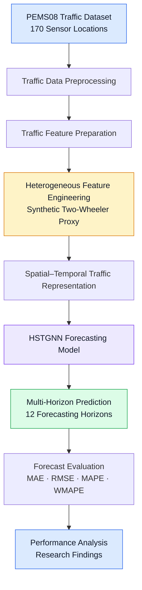
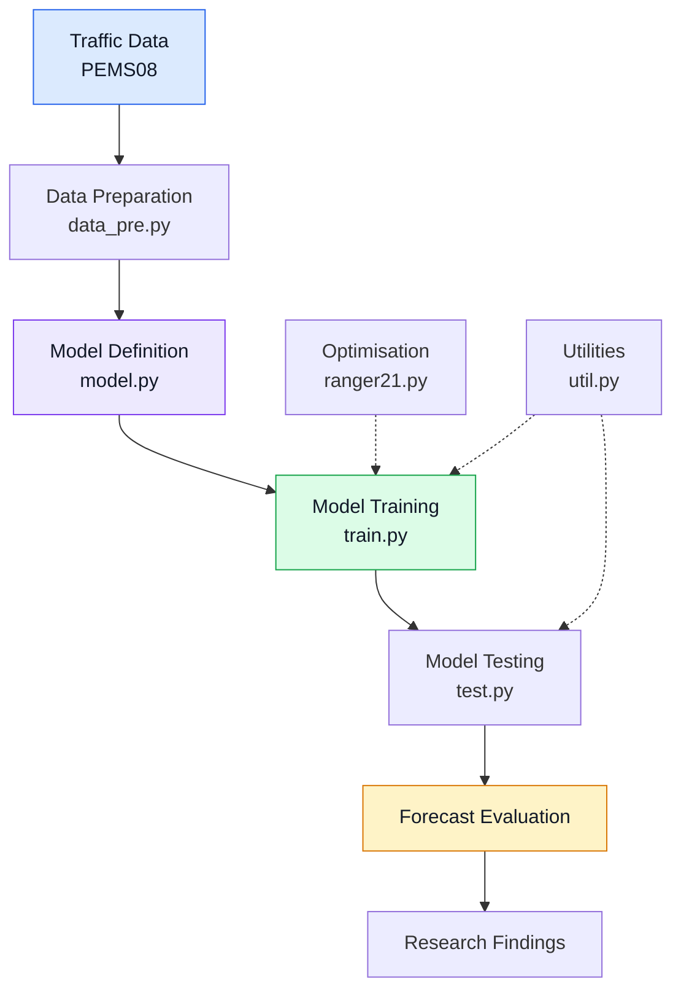
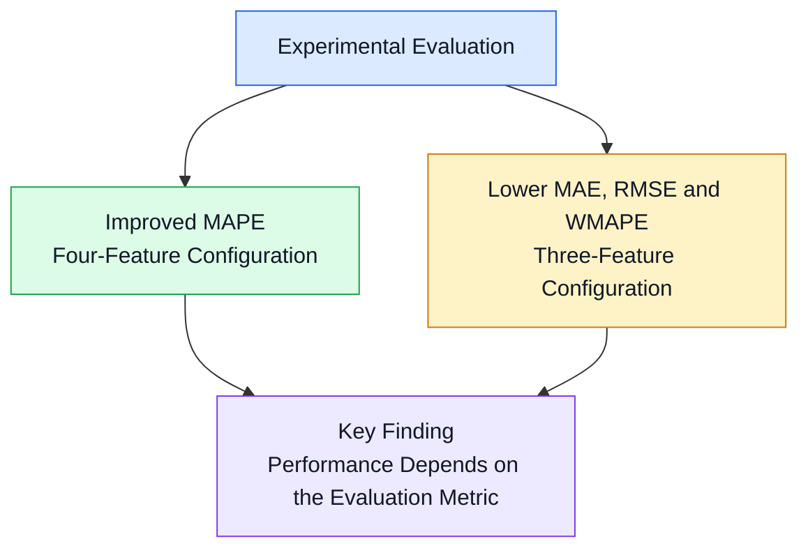

<div align="center">

# HSTGNN
## Heterogeneous Traffic Forecasting Using Spatial–Temporal Graph Neural Networks

### Predicting Two-Wheeler and Motorcycle-Related Congestion Dynamics

**MSc Data Science Dissertation | University of Surrey**


**Researcher:** Janani Veerakumar

*Beyond Predictions: What Data Reveals, What Models Miss & What Decisions Need.*

</div>

---

## 01 | Research Overview

Urban traffic networks exhibit complex relationships across locations and time. Accurate forecasting requires models capable of learning these spatial and temporal dependencies while accounting for variations in traffic conditions.

This research investigates **heterogeneous traffic forecasting through a Hybrid Spatial–Temporal Graph Neural Network (HSTGNN)**.

The study focuses on the influence of traffic-composition information on forecasting behaviour, with particular attention to two-wheeler-related characteristics.

Using the **PEMS08 traffic dataset**, the research combines graph-based traffic representation, temporal forecasting and synthetic feature engineering to investigate prediction accuracy across multiple forecasting horizons.

### Research Profile

| Category | Description |
|:---|:---|
| **Research Title** | Modelling Heterogeneous Traffic Flows: A Spatial–Temporal Graph Attention Network for Predicting Two-Wheeler and Motorcycle Congestion Dynamics |
| **Researcher** | Janani Veerakumar |
| **University** | University of Surrey |
| **Programme** | MSc Data Science |
| **Research Domain** | Intelligent Transportation Systems |
| **Core Model** | HSTGNN |
| **Dataset** | PEMS08 |
| **Traffic Sensors** | 170 |
| **Forecasting Horizons** | 12 |
| **Implementation Language** | Python |

---

## 02 | Problem Statement

### Understanding Heterogeneous Traffic Dynamics

Traffic conditions are influenced by interactions between road segments, historical traffic behaviour and variations in traffic composition.

Traditional traffic measurements may not explicitly describe how different vehicle categories contribute to congestion patterns.

This creates a research challenge:

> **How can heterogeneous traffic information be represented within a spatial–temporal graph forecasting framework, and what effect does that representation have on traffic prediction accuracy?**

This research examines that question using an engineered two-wheeler-related feature and a multi-horizon HSTGNN forecasting framework.

---

## 03 | Research Objectives

| Objective | Research Focus | Intended Outcome |
|:---|:---|:---|
| **01** | Spatial–temporal analysis | Investigate relationships between traffic locations and historical observations |
| **02** | Graph-based forecasting | Apply HSTGNN modelling to traffic prediction |
| **03** | Heterogeneous feature engineering | Develop a synthetic two-wheeler-related traffic feature |
| **04** | Multi-horizon prediction | Evaluate traffic forecasting across 12 horizons |
| **05** | Performance evaluation | Assess forecasting errors using MAE, RMSE, MAPE and WMAPE |
| **06** | Research interpretation | Identify performance trade-offs, limitations and future opportunities |

### Central Research Aim

> To investigate how heterogeneous traffic feature engineering influences spatial–temporal graph neural network forecasting performance.

---

## 04 | HSTGNN Research Architecture

### End-to-End Research Framework

The research framework connects traffic observations, feature preparation, spatial–temporal modelling, multi-horizon forecasting and performance evaluation.



> **Architecture note:** This diagram describes the research workflow. The detailed internal neural-network architecture should be documented separately from the verified `model.py` implementation.

---

## 05 | Dataset and Traffic Representation

### PEMS08 Traffic Dataset

The research uses the **PEMS08 dataset**, containing traffic observations collected from a network of **170 traffic sensors**.

These observations provide the historical information used to model traffic behaviour and forecast future conditions.

### Dataset Overview

| Property | Research Configuration |
|:---|:---|
| **Dataset** | PEMS08 |
| **Sensor Network** | 170 traffic sensors |
| **Application** | Traffic forecasting |
| **Data Representation** | Traffic observations organised across sensors and time |
| **Prediction Task** | Multi-horizon traffic forecasting |
| **Forecasting Horizons** | 12 |

### Traffic Feature Engineering

The research investigates heterogeneous traffic characteristics using an engineered two-wheeler-related feature.

The feature is defined as:

```python
two_wheeler_ratio = 0.15 + 0.45 * flow_norm
```

Where `flow_norm` represents normalised traffic flow.

**Research interpretation:** The engineered feature is a synthetic proxy derived from traffic flow. It does not represent directly measured motorcycle counts or verified two-wheeler proportions.

This distinction is important when interpreting the model's forecasting results.

---

## 06 | Model Implementation

### Python Implementation Structure

The HSTGNN implementation is organised into components for data preparation, modelling, training, testing and supporting operations.

| Component | Python Module | Function |
|:---|:---|:---|
| **Data Preparation** | `data_pre.py` | Prepares traffic observations and generates training, validation and testing datasets |
| **Model Definition** | `model.py` | Contains the HSTGNN model implementation |
| **Training** | `train.py` | Supports the model training process |
| **Testing** | `test.py` | Supports forecasting evaluation |
| **Optimisation** | `ranger21.py` | Contains Ranger21 optimisation functionality |
| **Utilities** | `util.py` | Provides supporting implementation functions |

### Implementation Workflow



The module names above describe the HSTGNN implementation structure. Files should be linked here once the corresponding code has been added to this repository.

### Data Preparation

The preprocessing stage generates datasets for:

- Training
- Validation
- Testing

Prepared data is saved in compressed NumPy (`.npz`) format for subsequent modelling operations.

---

## 07 | Forecasting and Evaluation

### Multi-Horizon Forecasting

The research evaluates traffic predictions across **12 forecasting horizons**.

The forecasting framework investigates how historical traffic information can support predictions of future traffic conditions across the sensor network.

### Evaluation Metrics

| Metric | Full Name | Evaluation Focus |
|:---|:---|:---|
| **MAE** | Mean Absolute Error | Average magnitude of forecasting errors |
| **RMSE** | Root Mean Squared Error | Sensitivity to larger prediction errors |
| **MAPE** | Mean Absolute Percentage Error | Percentage-based prediction error |
| **WMAPE** | Weighted Mean Absolute Percentage Error | Error relative to the total observed traffic values |

Lower values indicate better performance for these error metrics.

---

## 08 | Experimental Findings

### Forecasting Performance

The dissertation investigated the effect of introducing the engineered heterogeneous traffic feature.

The following table presents the recorded experimental results.

| Evaluation Metric | Three-Feature Configuration | Four-Feature Configuration |
|:---|---:|---:|
| **MAE** | **14.3300** | 14.3466 |
| **RMSE** | **23.2007** | 23.4144 |
| **MAPE** | 0.1024 | **0.0966** |
| **WMAPE** | **0.0617** | 0.0618 |

### Performance Interpretation

The four-feature configuration achieved an approximately **5.66% relative reduction in MAPE**.

However, the three-feature configuration recorded lower MAE, RMSE and WMAPE values.

The findings indicate that heterogeneous feature engineering can influence forecasting behaviour, although the synthetic feature did not produce consistent improvements across every metric.

### Evaluation Summary



---

## 09 | Research Contributions

This dissertation investigates the role of heterogeneous traffic information in graph-based traffic forecasting.

### Key Contributions

| Research Area | Contribution |
|:---|:---|
| **Traffic Forecasting** | Investigated spatial–temporal forecasting using HSTGNN |
| **Feature Engineering** | Developed a synthetic two-wheeler-related traffic proxy |
| **Experimental Research** | Evaluated the influence of heterogeneous traffic information |
| **Forecast Evaluation** | Analysed performance across four forecasting metrics |
| **Research Interpretation** | Identified trade-offs between percentage-based and absolute error measures |
| **Future Development** | Established directions for vehicle-aware traffic forecasting research |

### Research Significance

The study highlights the importance of evaluating engineered features critically rather than assuming that additional information automatically improves forecasting performance.

---

## 10 | Technologies and Research Skills

| Category | Technologies and Concepts |
|:---|:---|
| **Programming** | Python |
| **Machine Learning** | Deep learning and predictive modelling |
| **Graph Learning** | Spatial–temporal graph neural networks |
| **Traffic Analytics** | Sensor-based traffic forecasting |
| **Feature Engineering** | Synthetic traffic-composition representation |
| **Data Processing** | Traffic preprocessing and dataset preparation |
| **Evaluation** | MAE, RMSE, MAPE and WMAPE |
| **Research Methods** | Experimental comparison and critical analysis |
| **Development Environment** | Google Colab |

---

## 11 | Research Limitations

The study identifies several limitations that are important for interpreting the findings.

| Limitation | Research Implication |
|:---|:---|
| **Synthetic feature** | The engineered two-wheeler proxy is not a directly observed vehicle-class measurement |
| **Mixed performance outcomes** | Improvement in MAPE did not correspond to improvements across all metrics |
| **Dataset scope** | Findings are based on experiments using PEMS08 |
| **Vehicle-specific interpretation** | Results cannot establish accuracy for motorcycle-only traffic forecasting |

These limitations inform the future development of more representative heterogeneous traffic forecasting systems.

---

## 12 | Future Research Directions

Future research could investigate:

1. Integration of real vehicle-class-specific traffic measurements.
2. Evaluation using additional traffic datasets.
3. Alternative approaches to heterogeneous feature engineering.
4. Detailed analysis of performance across individual forecasting horizons.
5. Improved representation of vehicle-specific congestion behaviour.

These directions are proposed opportunities for further research and are not presented as completed experiments.

---

## 13 | Research Notebook

### Google Colab

The dissertation experiments were developed using Google Colab.

**Research Notebook:**

[Open the HSTGNN Research Notebook](https://colab.research.google.com/drive/1tSGnQyi8Ck3bDB6oh2hdu6AVGZ6O8cng?usp=sharing)

The notebook and supporting files will be organised within the repository to improve accessibility and reproducibility.

Detailed installation and execution instructions will be added after the complete implementation has been reviewed.

---

## 14 | Research Authorship

**Janani Veerakumar**  
MSc Data Science  
University of Surrey

**Dissertation:**

*Modelling Heterogeneous Traffic Flows: A Spatial–Temporal Graph Attention Network for Predicting Two-Wheeler and Motorcycle Congestion Dynamics*

This repository presents my dissertation research, including the research methodology, heterogeneous feature engineering, experimental evaluation, analysis and findings.

---

## 15 | Licence

**Copyright © 2026 Janani Veerakumar — original contributions.**

Original software in this repository that I own and have the right to license is made available under the **Apache License, Version 2.0**.

See the [LICENSE](LICENSE) file for the applicable terms.

External datasets and any separately licensed components remain subject to their respective terms.

---

## 16 | References

### HSTGNN Implementation

[HSTGNN — STGTraffic GitHub Repository](https://github.com/STGTraffic/HSTGNN)

### Research Dataset

PEMS08 traffic dataset.

### Research Environment

[Google Colab Research Notebook](https://colab.research.google.com/drive/1tSGnQyi8Ck3bDB6oh2hdu6AVGZ6O8cng?usp=sharing)

---

<div align="center">

### Beyond Predictions

**What Data Reveals · What Models Miss · What Decisions Need**

**HSTGNN | MSc Data Science Research | University of Surrey**

</div>
