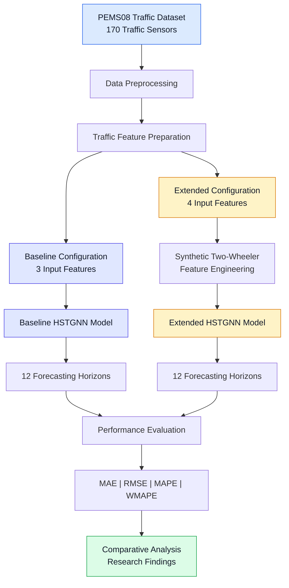
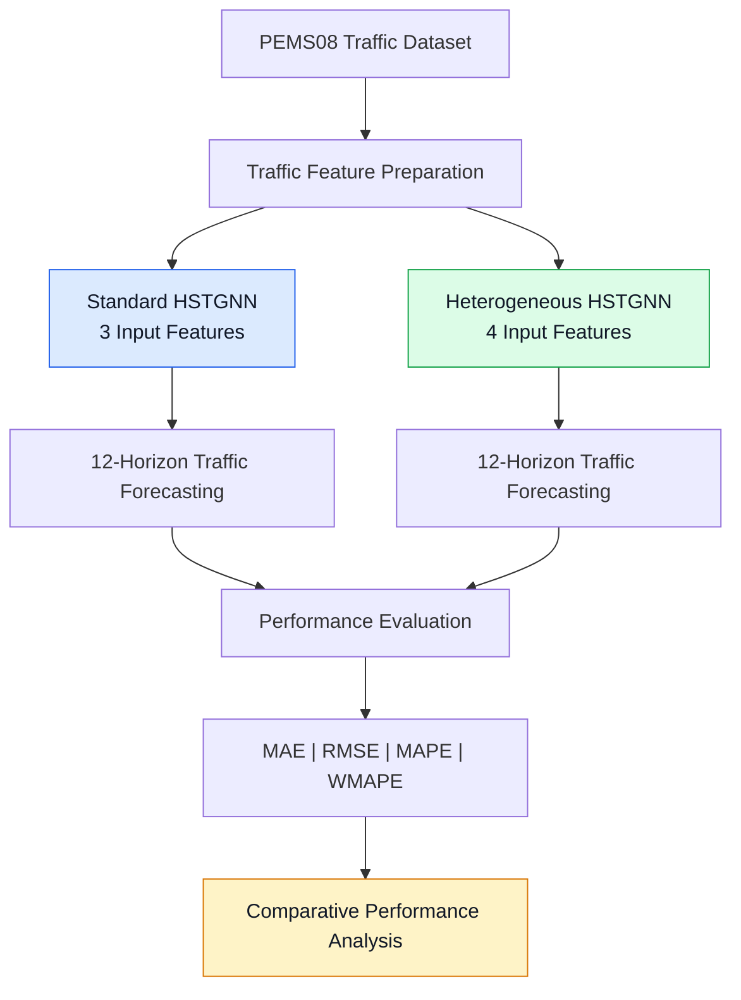

# HSTGNN | Heterogeneous Traffic Forecasting

### Modelling Heterogeneous Traffic Flows: A Spatial–Temporal Graph Attention Network for Predicting Two-Wheeler and Motorcycle Congestion Dynamics


---

## 1. Project Overview

This repository presents my MSc Data Science dissertation research conducted at the **University of Surrey**.

The project investigates heterogeneous traffic forecasting using a **Hybrid Spatial–Temporal Graph Neural Network (HSTGNN)**, with a particular focus on two-wheeler and motorcycle-related traffic characteristics.

The research extends an existing HSTGNN forecasting implementation by introducing a synthetic two-wheeler-related feature and evaluating its effect on multi-horizon traffic prediction using the PEMS08 dataset.

The aim is to investigate whether additional traffic-composition information can influence prediction accuracy and to understand the limitations of using synthetic features when real vehicle-class observations are unavailable.

**Researcher:** Janani Veerakumar  
**Programme:** MSc Data Science  
**Institution:** University of Surrey  
**Research Area:** Graph Neural Networks, Deep Learning and Traffic Forecasting

---

## 2. Problem Statement

### The Research Challenge

Traffic forecasting is challenging because traffic conditions change across locations and time periods.

Forecasting models need to account for:

- **Spatial dependencies:** Traffic conditions at one sensor location may influence other locations.
- **Temporal dependencies:** Historical traffic measurements affect future traffic patterns.
- **Traffic heterogeneity:** Different vehicle types can contribute differently to traffic behaviour.
- **Data limitations:** Vehicle-class-specific measurements may not be available.

### Research Question

> Can a synthetic feature representing two-wheeler-related traffic characteristics improve the forecasting performance of an HSTGNN-based traffic prediction model?

---

## 3. Research Objectives

The primary objective of this research is to investigate how heterogeneous traffic characteristics influence spatial–temporal traffic forecasting using a Hybrid Spatial–Temporal Graph Neural Network (HSTGNN).

### Key Research Objectives

1. **Spatial–Temporal Traffic Analysis:** Investigate spatial relationships and temporal patterns across traffic sensor networks to understand congestion dynamics.

2. **HSTGNN-Based Forecasting:** Implement and evaluate an HSTGNN-based forecasting framework for modelling complex traffic patterns.

3. **Heterogeneous Feature Engineering:** Develop a synthetic two-wheeler-related traffic feature to investigate the influence of traffic-composition information on forecasting performance.

4. **Comparative Model Evaluation:** Conduct experiments using standard and heterogeneous HSTGNN configurations to assess the impact of the additional feature.

5. **Multi-Horizon Traffic Prediction:** Evaluate forecasting performance across 12 prediction horizons using the PEMS08 dataset.

6. **Performance Analysis:** Assess model accuracy using MAE, RMSE, MAPE and WMAPE to identify improvements, trade-offs and limitations.

### Research Aim

> To investigate the potential of heterogeneous traffic feature engineering in spatial–temporal graph neural networks and evaluate its influence on multi-horizon traffic forecasting accuracy.

---

## 4. Research Workflow Architecture

The following diagram illustrates the experimental workflow used in this research.



**Note:** This diagram represents the experimental workflow rather than the internal neural-network layers.

---

## 5. How the Model Works

### Stage 1 — Traffic Data

The research uses the **PEMS08 dataset**, containing traffic measurements from 170 sensors.

These measurements provide historical traffic information for forecasting.

### Stage 2 — Data Preprocessing

Traffic observations are prepared for use in the forecasting model.

The data is organised into historical input sequences and forecasting targets.

### Stage 3 — Feature Engineering

Two configurations are evaluated:

| Configuration | Input Features | Description |
|---|---:|---|
| Baseline HSTGNN | 3 | Original traffic features |
| Extended HSTGNN | 4 | Original features plus a synthetic two-wheeler proxy |

The synthetic feature is calculated using:

```python
two_wheeler_ratio = 0.15 + 0.45 * flow_norm
```

**Important:** This feature is derived from normalised traffic flow. It is not a measured motorcycle count or a real observed vehicle-class ratio.

### Stage 4 — Spatial–Temporal Modelling

The HSTGNN framework models relationships across traffic sensor locations and historical time periods.

- **Spatial modelling:** Represents relationships between traffic sensors.
- **Temporal modelling:** Captures changes in traffic measurements over time.
- **Graph-based modelling:** Uses a graph representation of the traffic network.
- **Forecasting:** Estimates future traffic conditions using historical observations.

### Stage 5 — Multi-Horizon Forecasting

The model is evaluated across **12 forecasting horizons**.

### Stage 6 — Evaluation

The baseline and extended models are compared using:

- **MAE:** Mean Absolute Error.
- **RMSE:** Root Mean Squared Error.
- **MAPE:** Mean Absolute Percentage Error.
- **WMAPE:** Weighted Mean Absolute Percentage Error.

---

### Stage 6 — Model Performance Evaluation

To investigate the influence of heterogeneous traffic features on forecasting accuracy, two HSTGNN configurations were evaluated using the PEMS08 dataset.

#### Experimental Configurations

| Research Component | Standard HSTGNN | Heterogeneous HSTGNN |
|:---|:---|:---|
| **Input Features** | 3 traffic features | 4 traffic features |
| **Feature Engineering** | Standard traffic measurements | Includes a synthetic two-wheeler-related feature |
| **Dataset** | PEMS08 | PEMS08 |
| **Traffic Sensors** | 170 | 170 |
| **Forecasting Horizons** | 12 | 12 |
| **Evaluation Metrics** | MAE, RMSE, MAPE, WMAPE | MAE, RMSE, MAPE, WMAPE |
| **Research Purpose** | Establish reference forecasting performance | Investigate the effect of heterogeneous traffic representation |

#### Model Evaluation Workflow



#### Evaluation Metrics

| Metric | Full Form | Evaluation Purpose |
|:---|:---|:---|
| **MAE** | Mean Absolute Error | Measures average absolute prediction error |
| **RMSE** | Root Mean Squared Error | Places greater emphasis on larger prediction errors |
| **MAPE** | Mean Absolute Percentage Error | Measures prediction errors relative to actual values |
| **WMAPE** | Weighted Mean Absolute Percentage Error | Measures total absolute error relative to total observed values |

**Evaluation Objective:** Determine whether introducing a synthetic two-wheeler-related feature improves forecasting performance and identify trade-offs across different error metrics.
---

## 7. Research Contributions

This research investigates how heterogeneous traffic characteristics can be incorporated into spatial–temporal graph-based traffic forecasting.

The key contributions of this study include:

- Designing an experimental framework to investigate heterogeneous traffic representation.
- Developing a synthetic two-wheeler-related feature to examine traffic-composition effects.
- Implementing and evaluating standard and heterogeneous HSTGNN configurations.
- Conducting multi-horizon traffic forecasting experiments using the PEMS08 dataset.
- Evaluating model performance using MAE, RMSE, MAPE and WMAPE.
- Identifying the strengths, limitations and potential applications of heterogeneous traffic feature engineering.

The research demonstrates how additional traffic-related features can influence prediction behaviour and provides insights for further investigation into vehicle-aware traffic forecasting.

---

## 8. Technologies and Skills Demonstrated

| Area | Technologies and Concepts |
|---|---|
| Programming | Python |
| Deep Learning | Neural-network-based traffic forecasting |
| Model | HSTGNN |
| Graph Learning | Spatial–temporal graph modelling |
| Feature Engineering | Synthetic traffic-composition feature |
| Dataset | PEMS08 |
| Model Evaluation | MAE, RMSE, MAPE and WMAPE |
| Research | Experimental comparison and critical evaluation |

---

## 9. Research Limitations

1. **Synthetic vehicle feature:** The additional feature does not represent directly measured motorcycle traffic.
2. **Mixed forecasting performance:** The extended model improved MAPE but not the other three metrics.
3. **Dataset scope:** The experiments were conducted using PEMS08.
4. **Vehicle-specific validation:** The results do not demonstrate motorcycle-specific prediction accuracy.

---

## 10. Future Research

Potential future improvements include:

- Integrating real vehicle-class-specific traffic observations.
- Evaluating additional traffic datasets.
- Comparing alternative feature-engineering methods.
- Investigating performance across forecasting horizons.
- Testing whether more representative traffic-composition data improves overall accuracy.

These are proposed directions rather than completed experiments.

---

## 11. Research Notebook

The research was developed using Google Colab.

**Google Colab Notebook:**

[View the Research Notebook](https://colab.research.google.com/drive/1tSGnQyi8Ck3bDB6oh2hdu6AVGZ6O8cng?usp=sharing)

Execution instructions and dependencies will be added after the notebook and required files have been reviewed.

---

## 12. Research Authorship

**Researcher:** Janani Veerakumar  
**Programme:** MSc Data Science  
**Institution:** University of Surrey

**Dissertation Title:**

*Modelling Heterogeneous Traffic Flows: A Spatial–Temporal Graph Attention Network for Predicting Two-Wheeler and Motorcycle Congestion Dynamics*

This repository documents my dissertation research, including the experimental methodology, heterogeneous traffic feature engineering, forecasting evaluation and research findings.

---

## 13. Copyright and Licence

**Copyright © 2026 Janani Veerakumar.**

Original software and research materials that I own and am entitled to license are made available under the **Apache License, Version 2.0**, where applicable.

See the [LICENSE](LICENSE) file for licensing terms.

External datasets and other materials subject to separate rights remain governed by their respective terms.

---

## 13. Copyright and Licence

**Copyright © 2026 Janani Veerakumar — original contributions only.**

Original software contributions in this repository that are owned by Janani Veerakumar and available for licensing are provided under the **Apache License, Version 2.0**, as specified in the repository's `LICENSE` file.

The licence does not automatically apply to:

- Third-party HSTGNN source code.
- External datasets, including PEMS08.
- Third-party research materials or figures.
- Content governed by separate copyright or institutional agreements.

Redistribution of third-party code requires permission under its original licence or another valid authorisation.

**Licence:** Apache License 2.0

---

## 14. Project Status

**Research status:** MSc dissertation completed.

**Repository status:** Research documentation and reproducibility materials are being organised for public presentation.

---

### Research Philosophy

**Beyond Predictions: What Data Reveals, What Models Miss & What Decisions Need.**
