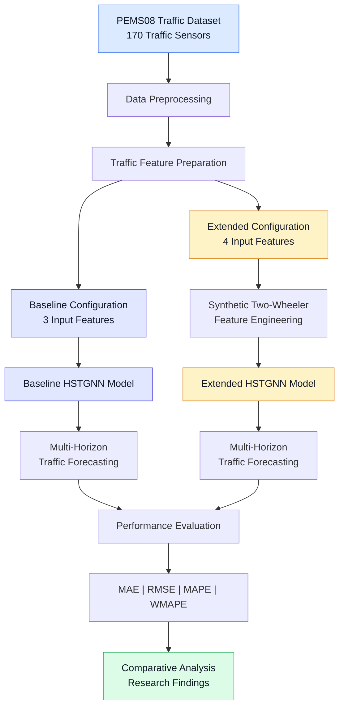
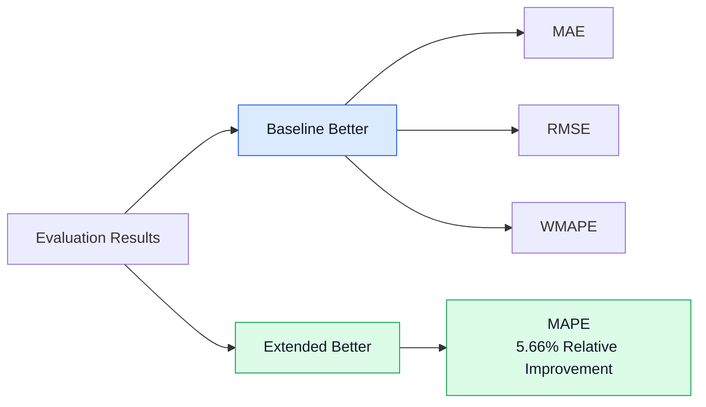

# Heterogeneous Traffic Forecasting Using HSTGNN

### Modelling Heterogeneous Traffic Flows: A Spatial–Temporal Graph Attention Network for Predicting Two-Wheeler and Motorcycle Congestion Dynamics


---

## 1. Project Overview

This project investigates heterogeneous traffic forecasting using a Hybrid Spatial–Temporal Graph Neural Network (HSTGNN).

Developed as part of my **MSc Data Science dissertation at the University of Surrey**, the research extends an existing HSTGNN implementation by introducing a synthetic two-wheeler-related feature and evaluating its effect on multi-horizon traffic prediction using the PEMS08 dataset.

The research examines how additional traffic-composition information can influence forecasting performance and highlights the limitations of using synthetic features when vehicle-type-specific observations are unavailable.

---

## 2. Problem Statement

### The Research Challenge

Traffic forecasting is challenging because traffic conditions change across different locations and time periods.

Traffic prediction models must account for:

- **Spatial dependencies:** Traffic conditions at one location can influence nearby locations.
- **Temporal dependencies:** Previous traffic patterns can influence future conditions.
- **Traffic heterogeneity:** Different vehicle types may contribute differently to congestion.
- **Data limitations:** Vehicle-type-specific traffic measurements are not always available.

### Research Question

> Can an additional feature representing two-wheeler-related traffic characteristics improve the forecasting performance of an HSTGNN-based traffic prediction model?

---

## 3. Research Objectives

1. Study spatial and temporal dependencies in traffic forecasting.
2. Examine an existing HSTGNN forecasting implementation.
3. Introduce a synthetic feature representing two-wheeler-related traffic characteristics.
4. Compare baseline and extended HSTGNN configurations.
5. Evaluate forecasting performance using MAE, RMSE, MAPE and WMAPE.
6. Identify limitations and potential improvements.

---

## 4. Research Workflow Architecture

The following diagram illustrates the high-level experimental workflow used in this research.



**Note:** This diagram represents the experimental workflow. It is not a detailed diagram of the internal neural-network layers.

---

## 5. How the Model Works

### Stage 1 — Traffic Data Collection

The research uses the **PEMS08 traffic dataset**, containing measurements from 170 traffic sensors.

The dataset provides traffic observations used for spatial–temporal forecasting.

### Stage 2 — Data Preprocessing

Traffic observations are prepared for model training and evaluation.

The preprocessing stage prepares historical traffic measurements for the forecasting model.

### Stage 3 — Feature Engineering

Two configurations are evaluated:

| Configuration | Number of Input Features | Description |
|---|---:|---|
| Baseline HSTGNN | 3 | Original traffic features |
| Extended HSTGNN | 4 | Original features plus synthetic two-wheeler proxy |

The additional feature is constructed using:

```python
two_wheeler_ratio = 0.15 + 0.45 * flow_norm
```

**Research clarification:** This is a synthetic feature derived from normalised traffic flow. It is not a measured motorcycle count or an observed vehicle-class ratio.

### Stage 4 — Spatial–Temporal Modelling

The HSTGNN framework models traffic patterns across both space and time.

- **Spatial modelling** considers relationships between traffic sensor locations.
- **Temporal modelling** considers how traffic measurements evolve over time.
- **Graph-based modelling** represents relationships between sensors.
- **Forecasting** uses historical observations to estimate future traffic conditions.

### Stage 5 — Traffic Forecasting

The research evaluates predictions across **12 forecasting horizons**.

### Stage 6 — Model Evaluation

The baseline and extended configurations are evaluated using four metrics:

- **MAE:** Mean Absolute Error.
- **RMSE:** Root Mean Squared Error.
- **MAPE:** Mean Absolute Percentage Error.
- **WMAPE:** Weighted Mean Absolute Percentage Error.

Lower values indicate better performance for these error metrics.

---

## 6. Experimental Results

### Baseline vs Extended HSTGNN

| Evaluation Metric | Baseline HSTGNN | Extended HSTGNN | Better Configuration |
|---|---:|---:|---|
| MAE | 14.3300 | 14.3466 | Baseline |
| RMSE | 23.2007 | 23.4144 | Baseline |
| MAPE | 0.1024 | 0.0966 | Extended |
| WMAPE | 0.0617 | 0.0618 | Baseline |

### Key Research Finding

> The extended configuration reduced MAPE by approximately **5.66%**, while MAE, RMSE and WMAPE showed small deteriorations.

These findings indicate that the additional synthetic feature influenced forecasting performance but did not consistently improve all evaluation metrics.

### Performance Visualisation

The following diagram summarises which configuration performed better for each metric.



---

## 7. Research Contributions

This dissertation builds on an existing HSTGNN forecasting implementation.

The research contributions include:

- Investigating heterogeneous traffic representation within an HSTGNN forecasting framework.
- Introducing a synthetic two-wheeler-related feature.
- Comparing three-feature and four-feature model configurations.
- Evaluating performance across multiple forecasting metrics.
- Analysing the implications and limitations of synthetic traffic-composition features.

The underlying HSTGNN architecture is attributed to its original researchers.

---

## 8. Technologies and Research Skills

| Area | Technologies / Concepts |
|---|---|
| Programming | Python |
| Deep Learning | Neural-network-based forecasting |
| Model Architecture | HSTGNN |
| Graph Learning | Spatial–temporal graph modelling |
| Data Processing | Traffic feature preparation |
| Dataset | PEMS08 |
| Evaluation | MAE, RMSE, MAPE, WMAPE |
| Research | Experimental comparison and critical evaluation |

---

## 9. Research Limitations

The research has several important limitations:

1. **Synthetic feature:** The additional two-wheeler-related variable is derived from normalised flow rather than observed vehicle-class data.
2. **Mixed performance:** Improvements in MAPE did not correspond to improvements across all evaluation metrics.
3. **Dataset scope:** Experiments were conducted using PEMS08.
4. **Vehicle-specific validation:** The results do not establish motorcycle-specific congestion prediction accuracy.

These limitations provide directions for further investigation.

---

## 10. Future Research Directions

Potential extensions include:

- Integrating real vehicle-class-specific traffic measurements.
- Evaluating the model on additional traffic datasets.
- Comparing different approaches to representing heterogeneous traffic.
- Investigating performance across different forecasting horizons.
- Examining whether alternative feature-engineering strategies improve overall forecasting accuracy.

These are proposed improvements, not completed experiments.

---

## 11. Reproducibility

The project was developed using a Google Colab research environment.

**Research notebook:**

[Open the Google Colab Notebook](https://colab.research.google.com/drive/1tSGnQyi8Ck3bDB6oh2hdu6AVGZ6O8cng?usp=sharing)

The complete execution instructions and dependency list will be documented after the notebook and its required data files have been verified.

---

## 12. Original Research and Attribution

**Dissertation Title:**

*Modelling Heterogeneous Traffic Flows: A Spatial–Temporal Graph Attention Network for Predicting Two-Wheeler and Motorcycle Congestion Dynamics*

**Programme:** MSc Data Science  
**Institution:** University of Surrey  
**Research Area:** Deep Learning, Graph Neural Networks and Traffic Forecasting

**Original HSTGNN implementation:**

[STGTraffic/HSTGNN](https://github.com/STGTraffic/HSTGNN)

This project builds upon the original HSTGNN research. Original architecture and third-party implementation contributions belong to their respective authors.

---

## 13. Licence and Reuse

The repository includes an Apache License 2.0 file.

The licence applies only to original software that the repository owner has the right to license. It does not automatically cover third-party HSTGNN code, external datasets, or materials subject to separate rights.

Any third-party code must be redistributed only where its original licence or explicit permission permits.

---

## 14. Project Status

**Status:** MSc dissertation research completed.

The repository documentation and reproducibility materials are being organised for public research presentation.

---

### Research Focus

**Beyond Predictions: What Data Reveals, What Models Miss & What Decisions Need.**
